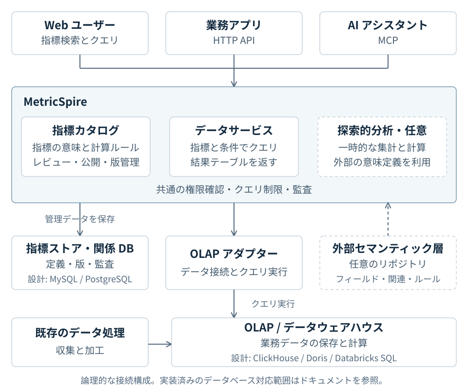

<h1 align="center">MetricSpire</h1>

<strong>指標カタログとデータサービスを、MCP で AI につなぐ。</strong>

<a href="README.md">English</a> · <a href="README.zh-CN.md">简体中文</a> · <strong>日本語</strong>

MetricSpire は、分析用データベース、業務アプリ、AI アシスタントをつなぐオープンソースの指標カタログとデータサービスです。チームで指標の意味と計算方法を管理し、アプリや AI が共通のインターフェースでデータを取得できます。

- **指標カタログ：** 指標の説明、計算ルール、版をまとめて管理し、検索・レビュー・公開できます。
- **データサービス：** 指標、期間、集計区分を指定して OLAP エンジン（分析用データベース）を問い合わせ、結果テーブルをアプリに返します。
- **MCP 接続：** AI アシスタントが指標を探し、定義を確認してデータサービスを呼び出せます。
- **探索的分析（任意）：** 外部のセマンティック層リポジトリを接続し、フィールドの意味、テーブル間の関連、業務ルールを使って一時的な分析を行えます。

## 注文の例で使い方を見る

以下は、利用の流れを説明するための架空のデータです。

**1. チームが指標を定義します。** 例えば「支払い済み注文数」は、支払いが成功した注文を注文 ID で重複排除し、支払日を基準に数えます。管理者が既存の OLAP テーブルと定義を結び付け、公開します。

**2. ユーザーが質問します。** 接続済みの AI アシスタントに尋ねます。

> 先週、地域ごとの支払い済み注文は何件ありましたか？

**3. サービスがデータを取得します。** AI アシスタントが指標を探し、質問をクエリに変換します。MetricSpire は権限を確認し、公開済みの定義に従って OLAP エンジンに問い合わせ、AI が表示する結果を返します。

| 地域 | 支払い済み注文数 |
| --- | ---: |
| 東部 | 120 |
| 南部 | 80 |

業務アプリも HTTP API から同じ指標を問い合わせ、その計算ルールを再利用できます。実際に使うには、チームでデータを接続し、定義を公開する必要があります。

**未登録の指標について追加で聞く場合は？** 例えば「そのうち、注文金額が 500 を超える注文の割合は？」という質問です。探索的分析を有効にすると、外部セマンティック層に設定した注文金額、地域、関連ルールを使って一時的なクエリを組み立てられます。固定指標を先に作る必要はありません。セマンティック層はデータの意味と使い方を定義し、実データの問い合わせは OLAP エンジンが担当します。入力形式は[外部セマンティック層の設定](docs/exploration.md)をご覧ください。

## データシステムでの役割

**既存のパイプラインがデータを収集・加工し、OLAP エンジンが業務データの保存と計算を行い、MetricSpire が指標管理とクエリサービスを担います。** 指標定義と版は別のリレーショナルデータベースに保存します。探索的分析には、任意で外部セマンティック層を接続できます。

実線はサービス呼び出しまたはデータ書き込み、破線は任意の意味定義の入力です。**OLAP エンジン、指標ストア、外部セマンティック層はそれぞれ役割が異なります。**

アダプターの設計対象は ClickHouse、Doris などの OLAP エンジンと、MySQL、PostgreSQL などの指標ストアです。**現在、このリポジトリには Databricks SQL 分析アダプターと PostgreSQL 指標ストアを実装しています。** PostgreSQL の事前集計データへの任意のクエリ機能もあります。ClickHouse、Doris、MySQL のアダプターはまだ含まれていません。[アーキテクチャと対応範囲](docs/architecture.md#adapter-support)をご確認ください。

## どこから始めますか？

> **開発プレビュー。** 自分のデータを問い合わせるには、設定済みのサービスとデータ権限が必要です。本番利用に対応した正式版はまだ公開していません。[現在の状況](docs/development-status.md)（英語）をご確認ください。

| 目的 | 入口 | 必要なもの |
| --- | --- | --- |
| ローカル Codex CLI からチームのサービスを使う | [チーム用インストーラーを入手](docs/mcp-installer.md#get-the-installer) | 稼働中のインスタンス、チームのインストーラー、その環境に必要な Databricks アクセス権。 |
| 別の MCP クライアントを接続する | [MCP 接続ガイド](docs/mcp.md#connect) | インスタンスの URL と、その環境に対応した認証設定。 |
| データに接続せず指標定義を試す | [オフラインサンプル](docs/getting-started.md#compile-and-inspect-a-plan-without-a-database) | Go のみ。データベースやクラウドアカウントは不要です。生成されるのはクエリ計画であり、データの結果ではありません。 |
| チーム用のサービスを構築する | [サービス設定](docs/getting-started.md#run-the-http-service) | 現在の実装では PostgreSQL、認証設定、Databricks SQL が必要です。 |

Web アクセス権がある場合は、チームのインスタンスを開き、**指標カタログ**から始めてください。このリポジトリには公開サービスのインスタンスや社内の指標定義は含まれていません。詳細ガイドは現在英語です。

## ドキュメントと開発状況

- [はじめに](docs/getting-started.md) — オフラインサンプル、ローカルカタログ、サービス設定。
- [MCP 接続](docs/mcp.md) · [HTTP API](docs/http-api.md) — クライアントやアプリとの接続。
- [アーキテクチャとアダプター](docs/architecture.md) — システムの役割、クエリ経路、現在のデータベース対応範囲。
- [チーム設定](config/README.md) · [外部セマンティック層](docs/exploration.md) — 非公開設定と探索的分析用の定義。
- [開発状況](docs/development-status.md) — 実装済みの機能、検証の根拠、残っている課題。
- [貢献ガイド](CONTRIBUTING.md) · [ドキュメント一覧](docs/README.md)。

詳細ドキュメントは現在英語です。上の注文例は製品説明用です。再現可能な技術的リクエストと期待結果は [TPCH 検証サンプル](testdata/acceptance/databricks-tpch)をご覧ください。意味定義の契約 [`metricspire.io/v1alpha1`](contracts/metricspire.schema.json) と予定する製品版 `v0.1.0` は別々にバージョン管理します。

[Apache 2.0](LICENSE) ライセンスです。公開サンプルは中立なデータを使います。社内定義、認証情報、本番データはこのリポジトリに含めないでください。
