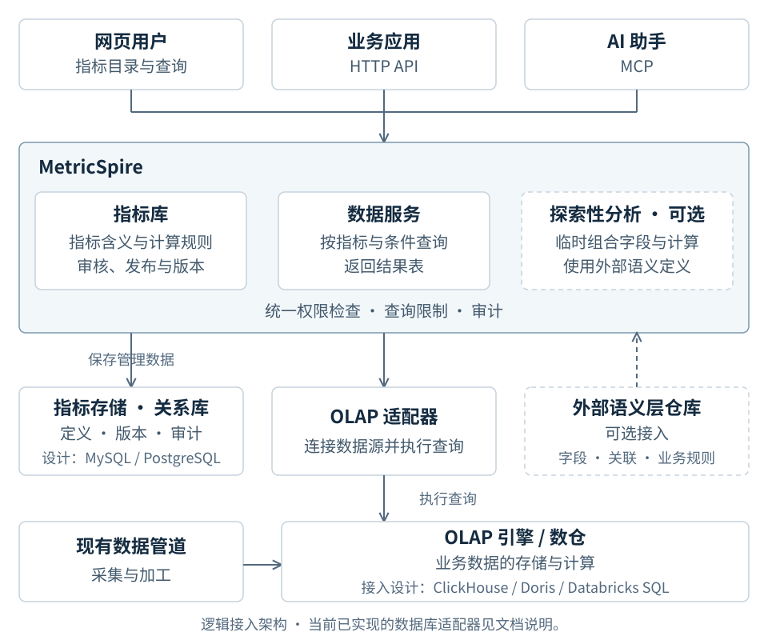

便携部署与引擎配置：[运行时引擎](docs/runtime-engines.md)。

结构化口径选择：[指标定义](docs/metric-definitions.md)。

<h1 align="center">MetricSpire</h1>

<strong>指标库与数据服务，通过 MCP 连接 AI。</strong>

<a href="README.md">English</a> · <strong>简体中文</strong> · <a href="README.ja.md">日本語</a>

MetricSpire 是一个开源的指标库与数据服务，连接你的分析数据库、业务应用和 AI 助手。团队在这里管理“一个指标是什么意思、怎么算”，应用和 AI 通过统一接口获取数据。

- **指标库**：集中维护指标说明、计算规则和版本，供团队查找、审核与发布。
- **数据服务**：按指标、时间和分组条件查询 OLAP 引擎（用于分析的数据库），向应用返回结果表。
- **MCP 接入**：让 AI 助手查找指标、了解定义，并调用数据服务回答问题。
- **探索性分析（可选）**：外接语义层仓库，利用其中的字段含义、表关联和业务规则进行临时分析。

## 用一个订单场景说明

以下是虚构数据，用来说明使用过程。

**① 团队先定义指标。** 例如“已支付订单数”：只统计支付成功的订单，按订单编号去重，按支付日期统计。维护者把这个定义关联到现有 OLAP 表并发布。

**② 用户提出问题。** 在已连接的 AI 助手中询问：

> 上周各地区有多少笔已支付订单？

**③ 服务查询并返回结果。** AI 助手找到这个指标，将问题转换成查询请求；MetricSpire 检查权限，按已发布的定义查询 OLAP 引擎，返回结果供 AI 展示：

| 地区 | 已支付订单数 |
| --- | ---: |
| 华东 | 120 |
| 华南 | 80 |

业务应用也可以通过 HTTP API 查询同一个指标，复用它的计算规则。实际使用前，需要由团队接入数据并发布定义。

**如果还想临时追问呢？** 比如“其中金额超过 500 元的订单占比是多少？”，但指标库里还没有这个指标。启用探索性分析后，AI 可以利用外接语义层中已配置的订单金额、地区和关联规则组织临时查询，无需先创建固定指标。语义层提供数据的含义和用法；实际数据仍由 OLAP 引擎查询。接入格式见[外部语义层配置](docs/exploration.md)。

## 它在数据系统里负责哪一部分？

**现有数据链路负责采集和加工，OLAP 引擎保存并计算业务数据，MetricSpire 负责管理指标和提供查询服务。** 指标定义与版本保存在单独的关系型数据库中；外接语义层为可选的探索性分析提供依据。

图中实线表示服务调用或数据写入，虚线表示可选的语义配置输入。**OLAP 引擎、指标存储、外部语义层是三个不同的角色。**

接入设计面向 ClickHouse、Doris 等 OLAP 引擎，以及 MySQL、PostgreSQL 等指标存储。**当前仓库已实现 Databricks SQL 分析适配器和 PostgreSQL 指标存储**，另有可选的 PostgreSQL / ClickHouse 预计算汇总 HTTP/MCP 查询和受控 [Trino/Presto 探索](docs/trino-presto.md)；另支持 MySQL 8.4 元数据存储；Doris 适配器尚未提供，ClickHouse 暂不支持探索分析或分析类 MCP 查询。各路径的实现范围见[架构与适配器](docs/architecture.md#adapter-support)。

## 从哪里开始？

> **开发预览版。** 查询自己的数据前，需要部署并配置服务，以及相应的数据权限。目前尚无生产就绪的正式版本。[查看当前状态](docs/development-status.md)（英文）。

| 你的目标 | 入口 | 需要准备 |
| --- | --- | --- |
| 在本地 Codex CLI 中使用团队服务 | [获取团队安装器](docs/mcp-installer.md#get-the-installer) | 已部署的实例、团队提供的安装器，以及该部署所需的 Databricks 访问权限。 |
| 连接其他 MCP 客户端 | [MCP 连接指南](docs/mcp.md#connect) | 实例地址，以及该部署支持的身份认证配置。 |
| 不连接数据，先理解指标定义 | [运行离线示例](docs/getting-started.md#compile-and-inspect-a-plan-without-a-database) | Go；无需数据库或云账号。示例生成查询计划，不返回数据结果。 |
| 为团队部署服务 | [服务配置指南](docs/getting-started.md#run-the-http-service) | 需要 PostgreSQL 元数据、身份认证配置及[已支持的查询配置](docs/runtime-engines.md)。 |

已有网页访问权限？打开团队实例，从**指标目录**开始。仓库不附带公开服务实例，也不包含公司的指标定义。上述详细指南目前为英文。

## 文档与项目状态

- [快速上手](docs/getting-started.md) — 离线示例、本地指标目录与服务配置。
- [MCP 接入](docs/mcp.md) · [HTTP API](docs/http-api.md) — 连接客户端或应用。
- [架构与适配器](docs/architecture.md) — 系统分工、查询路径与当前数据库支持范围。
- [离线结果刷新](docs/online-refresh.md): PostgreSQL 类型化批次导出、独立对账与租户快照原子刷新。
- [ClickHouse 汇总查询服务](docs/clickhouse-online.md) · [runtime.clickhouse.example.yaml](examples/runtime.clickhouse.example.yaml).
- [团队配置](config/README.md) · [外部语义层](docs/exploration.md) — 维护私有配置与探索性分析所需的定义。
- [开发状态](docs/development-status.md) — 已实现能力、验证证据和待完成项。
- [贡献指南](CONTRIBUTING.md) · [全部文档](docs/README.md)。

详细文档目前为英文。上面的订单场景用于产品说明；可复现的技术请求与预期结果见 [TPCH 验证样例](testdata/acceptance/databricks-tpch)。语义契约 [`metricspire.io/v1alpha1`](contracts/metricspire.schema.json) 与计划中的产品 `v0.1.0` 分别管理版本。

采用 [Apache 2.0](LICENSE) 许可。公开示例使用中立数据；公司定义、凭据和生产数据应保留在仓库之外。
