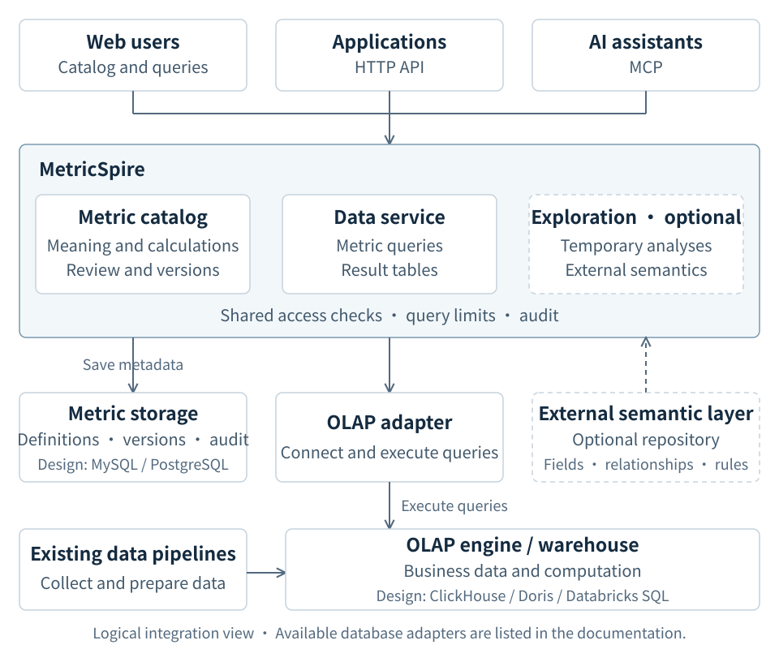

# Architecture

MetricSpire sits between data consumers and the engines that query business data. It manages metric definitions and exposes data queries through HTTP and MCP. The web UI uses the same HTTP services.

## Integration architecture

Solid arrows show service calls or data writes. The dashed arrow supplies optional semantic configuration. The diagram separates three responsibilities:

| Responsibility | What belongs there | Integration design |
| --- | --- | --- |
| OLAP engine / warehouse | Business tables and query computation, populated by existing data pipelines. | Analytical adapters for engines such as ClickHouse, Doris or Databricks SQL. |
| Metric store | Metric definitions, immutable versions, publication state and audit records. | A relational repository, such as MySQL or PostgreSQL. This is a separate adapter family from query execution. |
| External semantic-layer repository, optional | Field meanings, source definitions, approved relationships and business rules used to build temporary analyses. | Reviewed definitions exported to MetricSpire's structured analysis-catalog format. Business rows remain in the query engine. |

The table describes integration roles, not a list of shipped adapters. The current implementation is below. MetricSpire is a modular monolith; the semantic contract, `metricspire.io/v1alpha1`, is versioned independently of the product release.

## Adapter support

| Path | Shipped implementation | Scope |
| --- | --- | --- |
| Metric storage | [PostgreSQL repository](../internal/repository/postgres) | Catalog lifecycle, versions and durable audit. MySQL is an extension target; its repository adapter is not implemented. |
| Analytical metric queries | [Databricks SQL adapter](../internal/adapter/databricks) | Published metrics, bounded asynchronous execution, HTTP, web queries and MCP. ClickHouse and Doris adapters are not implemented. |
| Exploratory queries, opt-in | Databricks analysis adapter + external `AnalysisCatalog` | Temporary queries over approved fields and relationships through HTTP/MCP, with separate execution budgets. No metric registration is required. |
| Precomputed aggregate queries, opt-in | [PostgreSQL query adapter](../internal/adapter/postgresquery) | A separate synchronous HTTP path with reviewed SUM-based aggregates, freshness checks and a read-only credential. It does not provide general OLAP analysis or MCP tools. |

The [`serve` bootstrap](../cmd/metricspire/serve.go) defaults to PostgreSQL storage and Databricks analytical execution. An explicit `query_engine.driver: disabled` profile supports OIDC plus PostgreSQL-only online serving without Databricks credentials or clients. Storage, analytical queries, online serving and exploration have separately validated driver configuration; ClickHouse, Doris, MySQL and Trino/Presto adapters remain unimplemented and are rejected before startup. See [runtime engines](runtime-engines.md).

Adding an OLAP engine requires an implementation of [`QueryEngine`](../internal/application/query.go), explicit capabilities, compatible source bindings, execution/cancellation handling, bootstrap wiring and conformance tests. Exploration has a separate `AnalysisEngine` contract in [the analysis service](../internal/application/exploration.go); metric-query support alone does not enable it. Adding a metric store instead requires the catalog repository and audit contracts, including transactional publication and migration behavior. These two extension paths must remain separate.

The opt-in [online HTTP path](online-query.md) uses PostgreSQL as a business-data source, separately from PostgreSQL's catalog-storage role. Its source bindings, SELECT-only credential and short handling budget are independent of analytical execution. Requests never silently switch paths after a failure.

## Component boundaries

Optional [exploration](exploration.md) adds a trusted external `AnalysisCatalog`
and typed `AnalysisQuery` path: authorized detail sources and associations,
temporary expressions, two aggregation stages, and audited asynchronous jobs.
It uses separate warehouse budgets and does not require result metric registration.

1. **Publish:** validate a metric draft, compile its definition and save an immutable release in the metric store. Publication changes the active release pointer and retains history.
2. **Query a metric:** authenticate the caller, resolve the active release, check policy, build a logical plan, bind it to the configured engine, record admission, execute and record completion before returning a typed result. HTTP and MCP call the same query application service; the web UI calls HTTP.
3. **Explore:** load reviewed external semantics, authorize the requested sources and fields, plan a temporary query, and execute it through the analysis adapter with its own jobs and budgets. This path can run without a registered metric and does not inherit all source permissions from the metric catalog.

- `CatalogRepository` owns transactional drafts, revisions, releases, the active pointer, and release events. PostgreSQL stores JSONB definitions and manifests, not analytical facts or query results.
- `QueryEngine` owns analytical execution, capabilities, timeout/cancellation, and typed results. It is a different adapter family from `CatalogRepository`.
- `SourceBinding` maps logical datasets and fields to structured physical resources for one engine and environment. It contains no credentials or SQL fragments.
- Databricks-specific SQL and HTTP behavior stays under `internal/adapter/databricks`; the semantic, catalog, application, and planner packages do not depend on it.
- `Authenticator` returns a trusted principal; the HTTP layer creates `RequestContext`. `PolicyResolver` and `BindingResolver` select trusted configuration by namespace/model/tenant. None of these values are accepted in a public query body.
- `JobManager` owns product job IDs, deadlines, ownership checks, status, and cancellation. The engine adapter still owns its remote statement lifecycle.
- query audit is fail-closed: an admission event must be durable before execution; completion-audit failure withholds the result. Audit rows contain fingerprints and outcome metadata, never SQL, filter values, credentials, or result rows.
- The PostgreSQL repository remains provider-neutral. Static deployments use a normal URL; a deployment adapter may instead supply a short-lived password before each new physical pool connection. The Databricks Apps adapter exchanges its service-principal OAuth token for a one-hour Lakebase database credential without persisting it, putting it in the URL, or exposing provider APIs to catalog code. Static URLs and Lakebase endpoint configuration are mutually exclusive, and TLS-disabled Lakebase connections fail closed.

## Semantic truth and portability

`SemanticModel` contains stable English query names, optional numeric external codes, localized display names, descriptions, ownership, dimensions, relationships, and a constrained expression tree. The external code is searchable but is not the internal identity; once assigned to a published metric it cannot be replaced. The model never accepts an arbitrary SQL expression. `SemanticManifest` is normalized, validated, immutable, and addressed by SHA-256.

`LogicalPlan` explains metric dependencies, dimensions, safe join paths, time semantics, output order, and lineage without selecting a SQL dialect. `PhysicalPlan` applies one validated `SourceBinding` after capability checks. An engine adapter then emits its own parameterized statement.

This is portability by explicit translation, not a claim that all engines are equivalent. The common core stays small; each adapter declares supported expressions, filters, time grouping, join cardinalities, and limits. Unsupported plans fail before execution. Engine-specific features require a typed capability and a reviewed contract change, not a raw-SQL escape hatch.

## Catalog lifecycle

Drafts use optimistic revisions. An unpublished metric may still change its structured formula; after publication, changing execution semantics requires a new metric identity. Publication recompiles the exact expected revision, enforces required ownership/business/verification metadata, compares it with the active release, and inserts a new immutable release. Releases carry a structured `certified` or `trial` channel; trial publication requires an explicit deployment allowlist and never changes an unverified definition to verified. A published metric code cannot disappear or change execution semantics silently; deprecation is explicit and irreversible. Rollback changes the active pointer to an existing immutable release. Deactivation removes that pointer without deleting release history. Both actions record events.

Query execution resolves the active release on the server. A caller cannot select an unpublished manifest or stale fingerprint.

## Authorization boundary

MetricSpire and the analytical engine enforce different layers:

- the engine remains authoritative for physical catalog/schema/table/view access and row/column security;
- MetricSpire governs metric discovery, publication, allowed metrics/dimensions, release state, request budgets, and audit context;
- a matching engine denial always wins; MetricSpire does not copy or bypass warehouse ACLs.

`RequestContext` becomes trusted only when a transport constructs it after authentication. The CLI accepts a context file solely for local and integration testing. The HTTP transport strictly rejects unknown query fields, including caller-supplied identity, policy, binding, engine, manifest fingerprint, or SQL, and invokes the same fail-closed policy path.

The HTTP package keeps a provider-neutral `Authenticator`; the first concrete adapter is standards-based OIDC. It verifies discovery metadata, JWKS signatures, issuer, audience, expiry, tenant, roles, and product permissions. Browser login uses Authorization Code + PKCE, state, nonce, and AES-256-GCM encrypted HTTP-only sessions derived from an ID token for the browser client. API callers use a signed JWT access token for the independently configured `bearer_audience`; the adapter rejects opaque tokens rather than introspecting them or accepting an ID token as an API credential. Databricks OAuth M2M remains a separate service-to-engine credential and can never represent an end user.

OIDC implementation tests use locally generated RSA signatures and an isolated protocol fixture. They prove the cryptographic and session behavior, not compatibility with a particular enterprise identity provider; issuer registration, redirect URI, claim mapping, and real login/logout remain deployment acceptance work.

The portable self-hosted profile initially uses a least-privileged read-only engine identity restricted to approved data resources. End-user identity passthrough is engine- and host-specific, so it must be implemented as an adapter rather than changing the semantic or policy core.

For the Databricks Apps profile, the platform authenticates access to the app. The Apps adapter is enabled only when its configured app name, workspace ID, public origin, and the managed runtime environment agree. It derives the principal from managed-ingress headers, uses the forwarded token with the bounded current-user API to bind those headers to one active Databricks identity, gives every such user `query:execute` plus one configured query-policy role, and grants `model:manage` only to one configured stable publisher group. This deliberately avoids a generic group-to-role permission engine. User-triggered SQL requires that request's short-lived token, so Unity Catalog evaluates the real user's catalog, table, row-filter, and column-mask permissions. The token is copied only into the asynchronous engine context and explicitly masked from policy, planning, audit, persistence, errors, and public job state. App service-principal authorization remains reserved for reviewed background/shared operations. See [development status](development-status.md) for deployment evidence and remaining checks.

## Determinism and integrity

The compiler sorts definition sets and preserves expression/query argument order where order changes meaning. Fingerprints use compact UTF-8 JSON with deterministic object keys and no timestamps. Compiled artifacts and plans are re-fingerprinted before use, so mutated content is rejected.

Fingerprints identify content; they are not signatures. A deployed control plane must still authenticate writers, protect PostgreSQL, and secure the artifact channel.

## Query and execution budgets

The planner limits metrics, dimensions, filters, values per filter, time windows (at most 366 calendar days), total parameters, SQL size, joins, and result rows before submission. Date-backed time fields declare a fixed `calendar_timezone` in the trusted source binding; planning rejects a different requested timezone or non-midnight boundary instead of implying a conversion the physical date cannot represent. Timestamp fields remain instant-based and may be grouped in an explicit IANA business timezone. The Databricks adapter carries the actual request row limit into the execution job, validates all result chunks cumulatively against the byte budget, and issues remote cancellation after caller cancellation or timeout.

Small typed JSON results are the v0.1 boundary. Streaming export, external result locations, distributed cross-engine execution, and materialization are later capabilities.

## HTTP and UI boundary

Management and query permissions are separate. Management endpoints validate, save drafts, publish, list releases, and rollback; query endpoints search the active catalog, explain, plan, submit jobs, fetch status, and cancel. Catalog search includes the governed semantic model, entity, typed metric expression, authorized dimension descriptions, supported time grains, and fixed calendar timezones without exposing physical resources. Explain creates only an authorized logical plan. Plan may resolve a physical binding and field lineage but never calls an analytical engine. Query submission is asynchronous, so network write deadlines are independent of query deadlines.

All dynamic JSON is decoded with unknown-field and duplicate-key rejection plus a byte limit. Responses carry request IDs, no-store and browser security headers; cross-origin state changes are rejected. Errors use one `application/problem+json` shape. The embedded UI has no separate business logic, token field, or fake login. Its management flow is registry list -> metric draft editor -> release review/publication; saving one metric writes a real optimistic draft revision, while publication remains a separate explicit action. Catalog, explain/plan/query, job cancellation, draft load/save/validation, publication, release listing, and rollback all call the same API and use the OIDC session.

`metricspire serve --config` performs explicit dependency assembly. Non-secret HTTP/OIDC/policy/binding routes come from strict YAML or JSON. PostgreSQL URLs, the 32-byte session key, optional OIDC client secret, and Databricks credentials come only from environment variables. Startup does not run migrations or perform an analytical query. Shutdown stops HTTP admission, cancels and waits for background jobs and their completion audit, then closes PostgreSQL.

The generic OCI image runs a static binary as a non-root numeric user with no shell. Migrations remain a separate one-shot command. `/health/live` checks only the process; `/health/ready` checks PostgreSQL with a bounded context and never probes Databricks, so deployment health cannot create warehouse traffic.

## Deployment profiles

The portable profile uses standard OIDC, PostgreSQL, and a configured analytical adapter. The OCI image runs the static binary as a non-root user; migrations are separate one-shot operations. Docker Compose is a local development convenience, not a production topology.

Databricks Apps is an environment-specific profile with managed ingress, platform resources, a Lakebase-backed PostgreSQL control plane, and forwarded user authorization for SQL. Its staging packaging and resource configuration live beside the source in [deploy/databricks-apps](../deploy/databricks-apps/README.md); they are not a portable installation recipe. Production use requires separate review.

## Current exclusions

MCP exposes the same query application services, without management, identity override, raw SQL, or internal-model selection tools. The stdio-to-HTTP bridge exists for development compatibility. Shared result cache, streaming export, arbitrary SQL, cross-engine joins, and multi-engine routing are not implemented. Additional engine adapters must independently prove contract conformance before being advertised.
